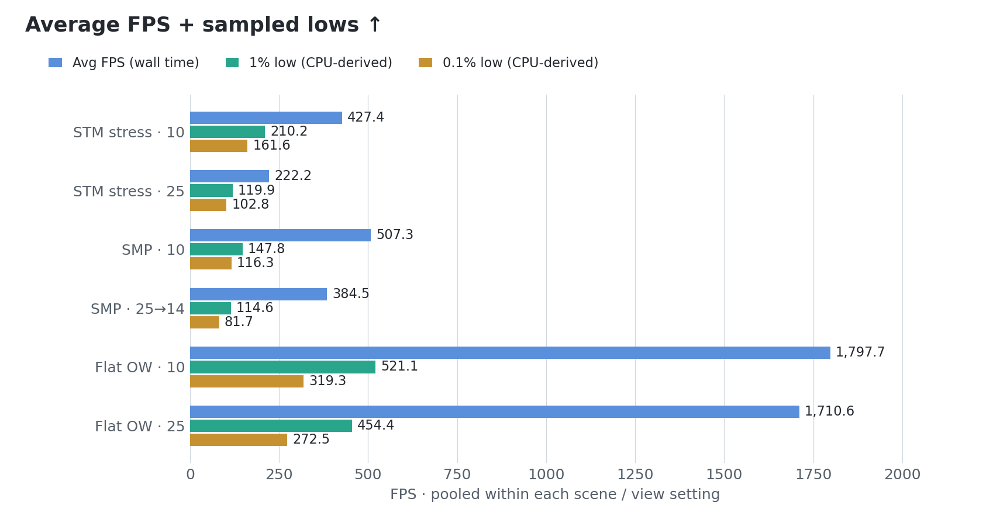
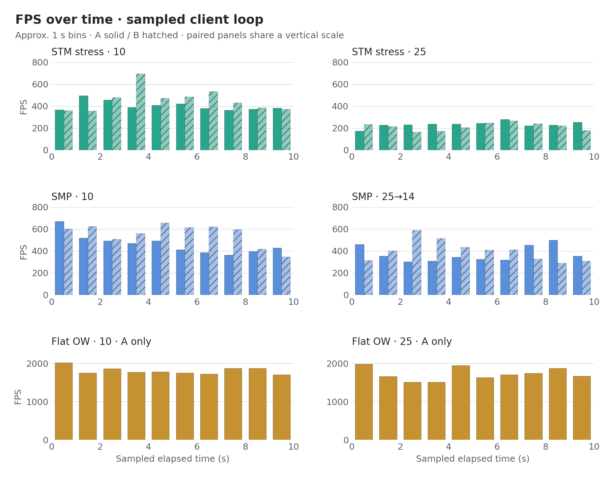

# Synthetic Terrain MC

**STM** is a Fabric tech demo: mineable MC blocks with continuous terrain motion,
shared collision and GPU rendering. Walk across waves, raise mountains or move
an entire view of terrain.

## Showcase

**Stress test** · 15 FPS

**Tiles + mining** · 20 FPS

## Performance

**STM stress: 427.4 FPS at 10 chunks; 222.2 FPS at 25 chunks.**
Populated SMP and superflat Overworld captures provide adjacent reference scenes.

**Ryzen 9 5900X · RX 9070 XT 16 GB · 32 GB RAM · 2560×1440**

Unlimited FPS, VSync off, Vulkan, FOV 110. Recorded 2026-10-14 with F3+L.

| Scene | View: client → effective | Runs | Avg FPS | p95 / p99 loop (ms) |
| --- | ---: | ---: | ---: | ---: |
| STM stress | 20 → 10 | 2 | 427.4 | 3.009 / 4.015 |
| STM stress | 25 → 25 | 2 | 222.2 | 6.053 / 7.308 |
| Populated SMP | 10 → 10 | 2 | 507.3 | 3.590 / 6.059 |
| Populated SMP | 25 → 14 | 2 | 384.5 | 5.516 / 7.673 |
| Superflat OW | 10 → 10 | 1 | 1,797.7 | 0.949 / 1.454 |
| Superflat OW | 25 → 25 | 1 | 1,710.6 | 1.020 / 1.607 |

The SMP pair requested 25 chunks but recorded **14 effective**. Superflat has
one run per distance; the other settings have two. These are different scenes,
not a controlled measurement of STM overhead. STM's 10-chunk pair used 0.2.2;
its 25-chunk pair used development build 0.3.0, not the downloadable 0.2.3.

<picture>
  <source media="(prefers-color-scheme: dark)" srcset="docs/benchmarks/fps-lows-dark.png">
  
</picture>

Lows use the mean duration of the slowest **1% / 0.1% of sampled CPU loops**,
converted to FPS. They describe these profiler samples, not display-presentation
lows. Average FPS still uses recorded wall time.

<picture>
  <source media="(prefers-color-scheme: dark)" srcset="docs/benchmarks/fps-timeline-dark.png">
  
</picture>

The timeline groups loops into approximately one-second bins using cumulative
sampled duration. It is not a wall-clock trace. A/B runs remain separate; the
last partial bin is retained. Paired panels share a scale within each scene.

CPU-derived low-FPS values

| Scene / effective chunks | 1% low | 0.1% low | Samples in slowest 0.1% |
| --- | ---: | ---: | ---: |
| STM stress / 10 | 210.2 | 161.6 | 9 |
| STM stress / 25 | 119.9 | 102.8 | 5 |
| SMP / 10 | 147.8 | 116.3 | 11 |
| SMP / 14 | 114.6 | 81.7 | 8 |
| Flat OW / 10 | 521.1 | 319.3 | 18 |
| Flat OW / 25 | 454.4 | 272.5 | 18 |

For each fraction `f`, take the slowest `ceil(N × f)` samples, then calculate
`1000 / mean(sample_ms)`. Paired runs are pooled before selecting the slowest
samples. The 0.1% figures use very few samples and can vary substantially.

Per-run FPS, loop timings and memory

Ten approximately 10 s captures; timings are CPU client-loop samples, including
waiting, not GPU execution or display-presentation times. No samples were trimmed
from included runs. One additional capture in the wrong dimension was excluded.

| Run | Frames | Duration (s) | Avg FPS | Mean ms | p50 | p95 | p99 | Max |
| --- | ---: | ---: | ---: | ---: | ---: | ---: | ---: | ---: |
| STM-10-A | 3,993 | 10.000 | 399.3 | 2.480 | 2.471 | 3.026 | 4.330 | 7.852 |
| STM-10-B | 4,556 | 10.000 | 455.6 | 2.185 | 2.247 | 2.986 | 3.436 | 5.714 |
| STM-25-A | 2,312 | 9.997 | 231.3 | 4.299 | 4.264 | 5.127 | 7.806 | 9.888 |
| STM-25-B | 2,132 | 10.000 | 213.2 | 4.670 | 4.381 | 6.152 | 6.702 | 8.783 |
| SMP-14-A | 3,697 | 10.000 | 369.7 | 2.687 | 2.398 | 5.727 | 8.067 | 17.608 |
| SMP-14-B | 3,993 | 10.001 | 399.3 | 2.492 | 2.146 | 5.312 | 7.266 | 9.819 |
| SMP-10-A | 4,611 | 10.000 | 461.1 | 2.160 | 1.994 | 4.109 | 6.142 | 9.915 |
| SMP-10-B | 5,535 | 10.000 | 553.5 | 1.799 | 1.494 | 3.385 | 5.864 | 9.508 |
| FLAT-10-A | 17,977 | 10.000 | 1,797.7 | 0.551 | 0.462 | 0.949 | 1.454 | 3.998 |
| FLAT-25-A | 17,106 | 10.000 | 1,710.6 | 0.580 | 0.487 | 1.020 | 1.607 | 6.448 |

| Run | Loops >8.33 ms | Loops >16.67 ms | Heap range (MiB) |
| --- | ---: | ---: | ---: |
| STM-10-A | 0 / 3,993 | 0 | 1,542–3,246 |
| STM-10-B | 0 / 4,556 | 0 | 3,782–6,040 |
| STM-25-A | 16 / 2,312 | 0 | 3,708–5,326 |
| STM-25-B | 4 / 2,132 | 0 | 5,850–7,624 |
| SMP-14-A | 22 / 3,697 | 1 | 1,256–7,826 |
| SMP-14-B | 10 / 3,993 | 0 | 1,334–7,750 |
| SMP-10-A | 4 / 4,611 | 0 | 1,394–7,846 |
| SMP-10-B | 2 / 5,535 | 0 | 1,380–7,830 |
| FLAT-10-A | 0 / 17,977 | 0 | 1,666–7,586 |
| FLAT-25-A | 0 / 17,106 | 0 | 1,948–7,516 |

Heap covers the whole client, other mods and garbage awaiting collection;
it is not STM-only memory or VRAM. `SMP-14` means 25 requested / 14 effective.
`FLAT` denotes the demo's superflat Overworld, outside the STM dimension.

<picture>
  <source media="(prefers-color-scheme: dark)" srcset="docs/benchmarks/stress-cpu-profile-dark.png">
  
</picture>

The pie uses **STM-25-B**. STM's render pass is subtracted from inclusive
render time so slices sum to 100%. Swap includes driver/presentation waiting.
These shares are not GPU utilization or STM's total overhead.

CPU profile, settings and methodology

| Configuration | Value |
| --- | --- |
| OS / Java | Windows 11 x64; Azul OpenJDK 25.0.1; 8 GiB heap; ZGC |
| MC / client | 26.2; Lunar with additional mods |
| Fabric | Loader 0.19.5; API 0.152.1 |
| Rendering mods | Sodium 0.9.2; Iris 1.11.4 |
| GPU driver | 32.0.31041.1004 |
| Graphics | Custom; fullscreen; clouds off; all particles; mipmaps 4; RGSS |
| Demo server | Dedicated process on the same PC; simulation distance 6 |
| SMP server | Separate reference world; server simulation distance unverified |

- FPS = rendered frame count / recorded wall duration, rounded by MC to ms.
  Group FPS uses total frames / total time.
- Loop timings come from `client/metrics/ticking.csv`, converted from ns to ms.
  Percentiles use nearest rank: `sorted[ceil(p × N) − 1]`. Group percentiles
  use pooled samples, not averages of run percentiles.
- All four STM runs were captured during `/stm stress 120`. Reference runs
  contain no STM terrain-render scope. Different worlds, entities, camera paths
  and stress builds prevent attributing differences solely to STM or view distance.
- Camera pose, mesh readiness and active shader-pack state were not independently
  recorded. Short client profiles do not establish presentation-based 1% lows,
  GPU execution time, server TPS/MSPT or long-session performance.

[Comparison data and capture hashes](docs/benchmarks/comparison-2026-10-14.json) ·
[Original stress data](docs/benchmarks/stress-2026-10-14.json)

Regenerate charts: `python tools/render_benchmarks.py` (Matplotlib).

To repeat: keep settings/camera fixed, wait for `/stm debug on` ready/loaded
meshes to match, record an idle F3+L window, then `/stm stress 120` and record
another after the initial ramp. Keep traversal captures separate.

## Install

[Download STM](dist/SyntheticTerrainMC.zip) · MC **26.2** · Java **25** ·
Fabric Loader **0.19+** · Fabric API **26.2**

Put the mod JAR in `mods/` on client and server. Install Fabric API separately.
Do not install the `-sources.jar`.

## Commands

| Command | Action |
| --- | --- |
| `/stm enter` / `leave` | Enter STM / return to your entry point. |
| `/trigger <type> [radius]` | Start motion; radius 8–128, default 48. |
| `/stm auto on\|off` | Toggle ambient motion. |
| `/stm hold on\|off` | Keep new formations raised. |
| `/stm reset` | Settle motion over 12 s; keep block edits. |
| `/stm regenerate [radius]` | **Erase edits** in loaded chunks; radius 0–8, default 4. |
| `/stm stress [seconds]` / `stress stop` | Swells across loaded terrain as you travel, 15–120 s. |
| `/stm debug on\|off` / `status` | Private CPU/cache/network stats. |
| `/stm selftest` / `benchmark` | Native checks / CPU probe; requires an empty STM dimension. |

Types: `wave`, `ripple`, `mirage`, `mountain`, `ridge`, `ravine`, `tiles`, `terraces`.
Changing shared terrain requires OP. `/epd` remains an alias; the internal `epd`
ID stays stable for save compatibility. Vanilla scoreboard `/trigger` still works.

Stress keeps its world-space phase while new chunks load. It affects loaded STM
terrain, including other players' views, without force-loading chunks. Client and
server must both use 0.2.3+ for matching physics and visuals.

## Build

JDK 25: `./gradlew build` or `gradlew.bat build`. JARs: `build/libs/`.
`python tools/package_release.py` creates the current download and SHA-256 sums.
Java: clang-format 22. Python: Black.

## Scope

White concrete and calcite move as vertical columns, within loaded chunks.
Mining/build edits persist; motion resets on server restart. No fluids, horizontal
building motion or shader-pack integration. SP runtime validation is pending.

[Architecture, tests and perf](docs/TECHNICAL.md) ·
[Issues](https://github.com/partywith8/SyntheticTerrain-MC/issues)

All rights reserved. See [LICENSE](LICENSE).
