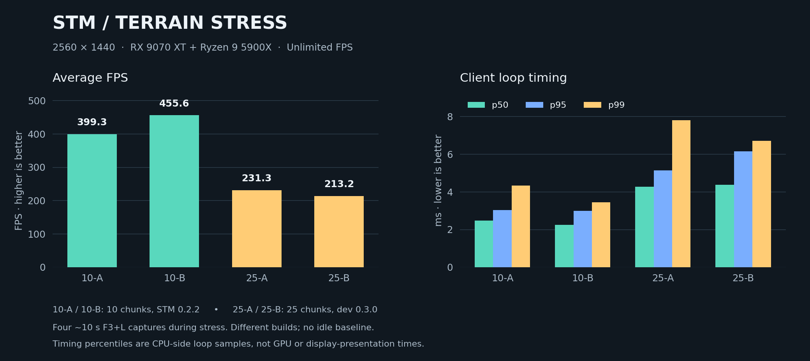
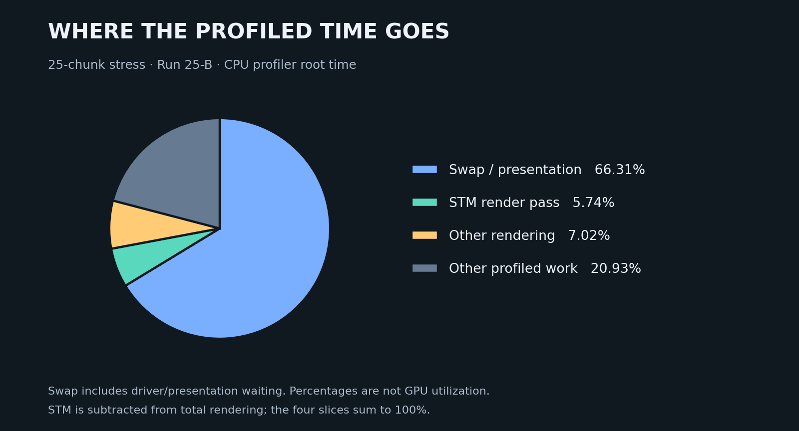

# Synthetic Terrain MC

**STM** is a Fabric tech demo: mineable MC blocks with continuous terrain motion,
shared collision and GPU rendering. Walk across waves, raise mountains or move
an entire view of terrain.

## Showcase

**Stress test** · 15 FPS

**Tiles + mining** · 20 FPS

## Performance

**Stress captures: 427.5 FPS at 10 chunks; 222.2 FPS at 25 chunks**
(pooled frame count / elapsed time across two runs per setting).

Recorded on **2026-10-14**, at **2560×1440**, during `/stm stress 120`.
All four F3+L captures are included in full; no samples were removed.

| Hardware / runtime | Configuration |
| --- | --- |
| CPU | Ryzen 9 5900X, 12C/24T |
| GPU | Radeon RX 9070 XT, 16 GB; driver 32.0.31041.1004 |
| RAM / JVM | 32 GB RAM; 8 GiB Java heap; ZGC |
| Platform | Windows 11 x64; MC 26.2; Azul OpenJDK 25.0.1 |
| Client | Lunar; Fabric Loader 0.19.5; Fabric API 0.152.1; Sodium 0.9.2; Iris 1.11.4 |
| Renderer | Vulkan; fullscreen; FOV 110; unlimited FPS; VSync off |
| Graphics | Custom preset; clouds off; all particles; mipmaps 4; RGSS filtering |
| Server | Dedicated process on the same PC; simulation distance 6 |

The client is modded beyond STM. These results describe that configuration.
The 25-chunk captures used local development build 0.3.0, not the downloadable
0.2.3 package; they are development measurements, not a benchmark of that release.

### Rendered FPS

| Run | STM | Effective / client view (chunks) | Duration (s) | Frames | Avg FPS |
| --- | --- | ---: | ---: | ---: | ---: |
| 10-A | 0.2.2 | 10 / 20 | 10.000 | 3,993 | 399.3 |
| 10-B | 0.2.2 | 10 / 20 | 10.000 | 4,556 | 455.6 |
| 25-A | 0.3.0 | 25 / 25 | 9.997 | 2,312 | 231.3 |
| 25-B | 0.3.0 | 25 / 25 | 10.000 | 2,132 | 213.2 |

Effective view is confirmed by the capture’s `lastViewDistance` samples:
10 throughout the first pair, 25 throughout the second. Client simulation
distance was 12 in all four captures; the server setting remained 6.

### Sampled client frame-loop time

Milliseconds; lower is better. These are CPU-side profiler samples, including
waiting inside the loop, rather than display-presentation or GPU execution times.

| Run | Mean | p50 | p95 | p99 | p99.9 | Max |
| --- | ---: | ---: | ---: | ---: | ---: | ---: |
| 10-A | 2.480 | 2.471 | 3.026 | 4.330 | 5.967 | 7.852 |
| 10-B | 2.185 | 2.247 | 2.986 | 3.436 | 5.300 | 5.714 |
| 25-A | 4.299 | 4.264 | 5.127 | 7.806 | 9.739 | 9.888 |
| 25-B | 4.670 | 4.381 | 6.152 | 6.702 | 8.535 | 8.783 |

| Run | Samples >8.33 ms | Samples >16.67 ms | Sampled heap range (MiB) |
| --- | ---: | ---: | ---: |
| 10-A | 0 / 3,993 | 0 | 1,542–3,246 |
| 10-B | 0 / 4,556 | 0 | 3,782–6,040 |
| 25-A | 16 / 2,312 | 0 | 3,708–5,326 |
| 25-B | 4 / 2,132 | 0 | 5,850–7,624 |

No sampled loop exceeded 16.67 ms in these windows. Heap values cover the whole
client, including other mods and garbage awaiting collection; they are not
STM-only memory or VRAM measurements.

CPU profiler breakdown and methodology

Share of profiled root time. `epd_terrain` is STM’s CPU render-pass scope,
nested within `render`; these columns must not be added together.

| Run | `swapBuffers` | `render` | `epd_terrain` |
| --- | ---: | ---: | ---: |
| 10-A | 67.73% | 12.03% | 2.21% |
| 10-B | 65.02% | 13.85% | 2.08% |
| 25-A | 67.90% | 12.48% | 5.63% |
| 25-B | 66.31% | 12.76% | 5.74% |

`swapBuffers` includes presentation/driver waiting. These scopes do not isolate
GPU work, establish a GPU bottleneck, or measure STM’s entire per-frame cost.

- FPS = rendered `frame` count / recorded wall time. Minecraft rounds the
  recorded duration to milliseconds. Its client profiler calls these samples
  “ticks”; this is not server TPS.
- Timings come from `client/metrics/ticking.csv`, converted from ns to ms.
  Percentiles use nearest rank: `sorted[ceil(p × N) − 1]`.
- No presentation-based 1% lows, GPU utilization, server TPS or MSPT are
  inferred from these client captures.
- Both pairs ran during stress. There is no idle baseline. STM changed from
  0.2.2 to 0.3.0 between pairs, including wider roaming stress coverage, so
  the difference cannot be attributed solely to render distance.
- Camera position, traversal, full STM mesh readiness and active shader-pack
  state were not independently established. Four short profiled windows
  do not establish long-session performance or results on other hardware.

[Aggregate data and capture SHA-256s](docs/benchmarks/stress-2026-10-14.json).
Regenerate figures with `python tools/render_benchmarks.py` (Matplotlib).

To repeat: keep settings/camera fixed, wait for `/stm debug on` ready/loaded
meshes to match, record an idle F3+L window, then `/stm stress 120` and record
another after the initial ramp. Keep traversal captures separate.

## Install

[Download STM](dist/SyntheticTerrainMC.zip) · MC **26.2** · Java **25** ·
Fabric Loader **0.19+** · Fabric API **26.2**

Put the mod JAR in `mods/` on client and server. Install Fabric API separately.
Do not install the `-sources.jar`.

## Commands

| Command | Action |
| --- | --- |
| `/stm enter` / `leave` | Enter STM / return to your entry point. |
| `/trigger <type> [radius]` | Start motion; radius 8–128, default 48. |
| `/stm auto on\|off` | Toggle ambient motion. |
| `/stm hold on\|off` | Keep new formations raised. |
| `/stm reset` | Settle motion over 12 s; keep block edits. |
| `/stm regenerate [radius]` | **Erase edits** in loaded chunks; radius 0–8, default 4. |
| `/stm stress [seconds]` / `stress stop` | Swells across loaded terrain as you travel, 15–120 s. |
| `/stm debug on\|off` / `status` | Private CPU/cache/network stats. |
| `/stm selftest` / `benchmark` | Native checks / CPU probe; requires an empty STM dimension. |

Types: `wave`, `ripple`, `mirage`, `mountain`, `ridge`, `ravine`, `tiles`, `terraces`.
Changing shared terrain requires OP. `/epd` remains an alias; the internal `epd`
ID stays stable for save compatibility. Vanilla scoreboard `/trigger` still works.

Stress keeps its world-space phase while new chunks load. It affects loaded STM
terrain, including other players' views, without force-loading chunks. Client and
server must both use 0.2.3+ for matching physics and visuals.

## Build

JDK 25: `./gradlew build` or `gradlew.bat build`. JARs: `build/libs/`.
`python tools/package_release.py` creates the current download and SHA-256 sums.
Java: clang-format 22. Python: Black.

## Scope

White concrete and calcite move as vertical columns, within loaded chunks.
Mining/build edits persist; motion resets on server restart. No fluids, horizontal
building motion or shader-pack integration. SP runtime validation is pending.

[Architecture, tests and perf](docs/TECHNICAL.md) ·
[Issues](https://github.com/partywith8/SyntheticTerrain-MC/issues)

All rights reserved. See [LICENSE](LICENSE).
